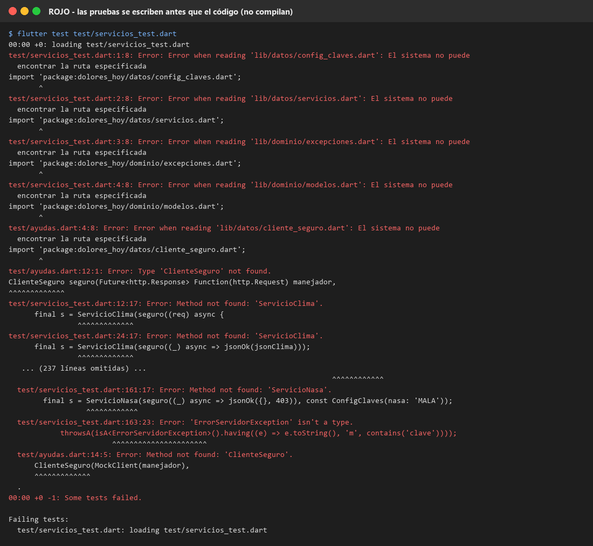
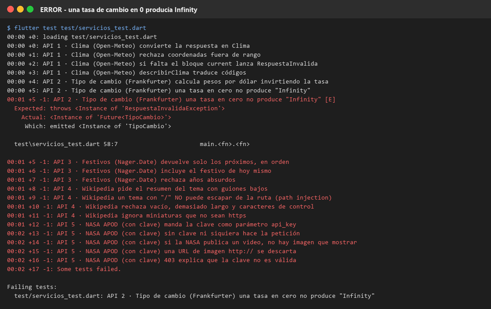
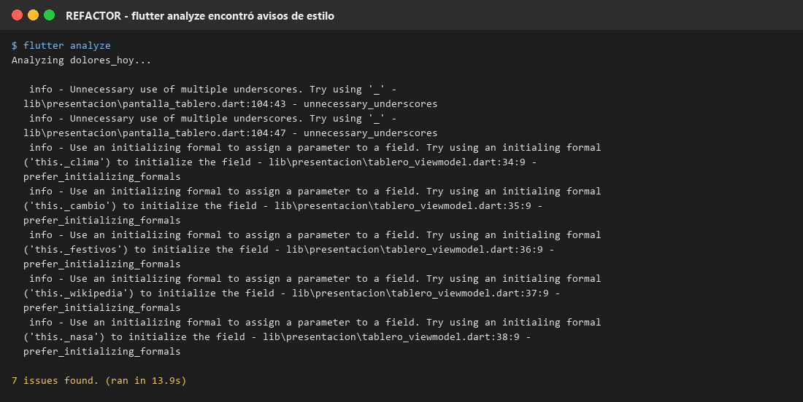
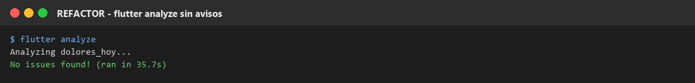
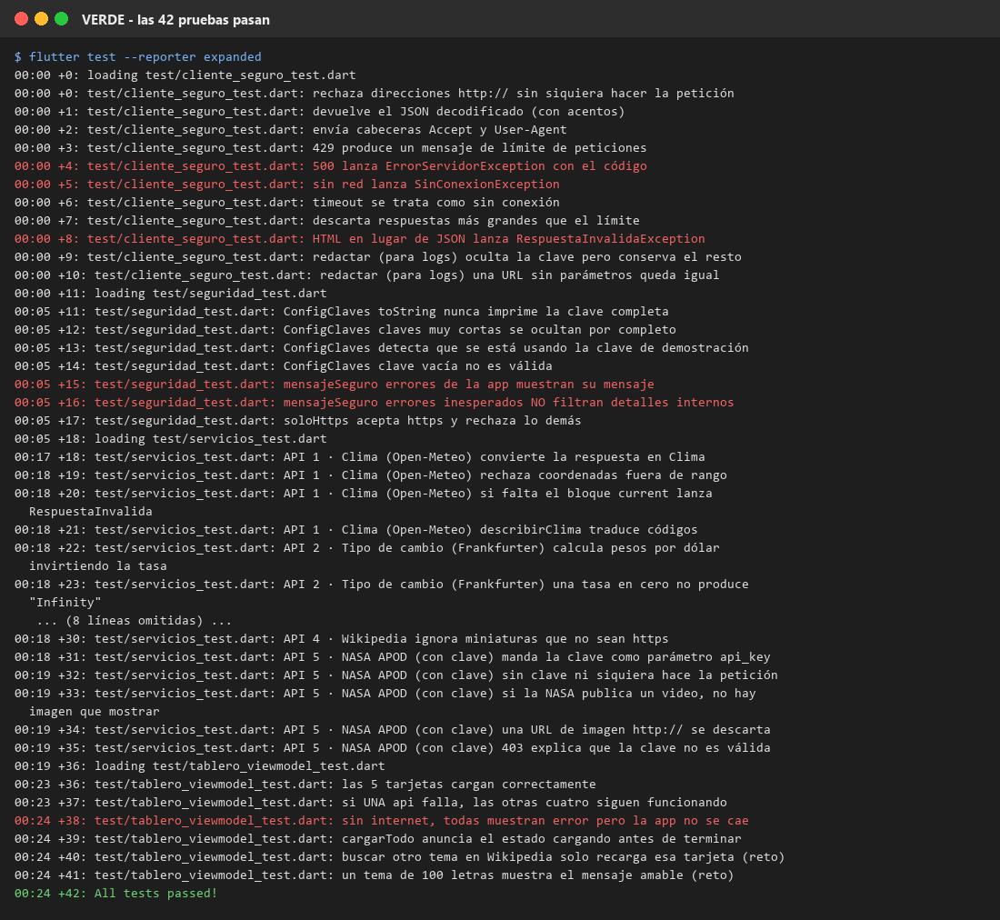
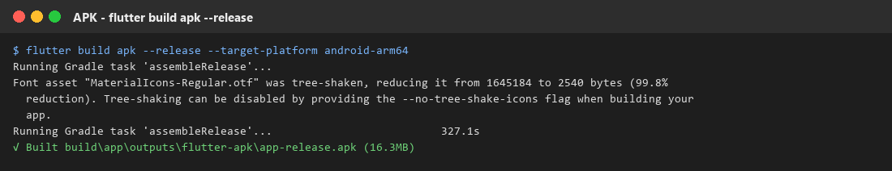
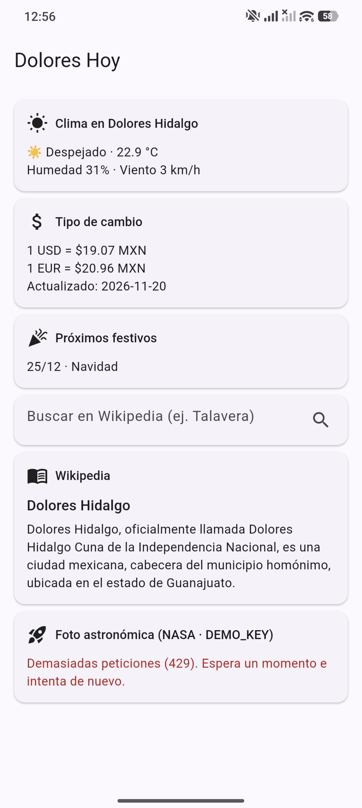
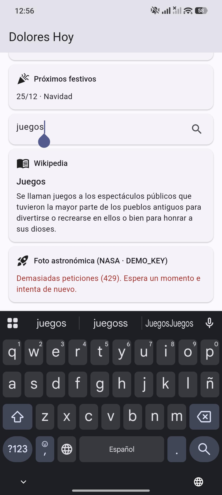
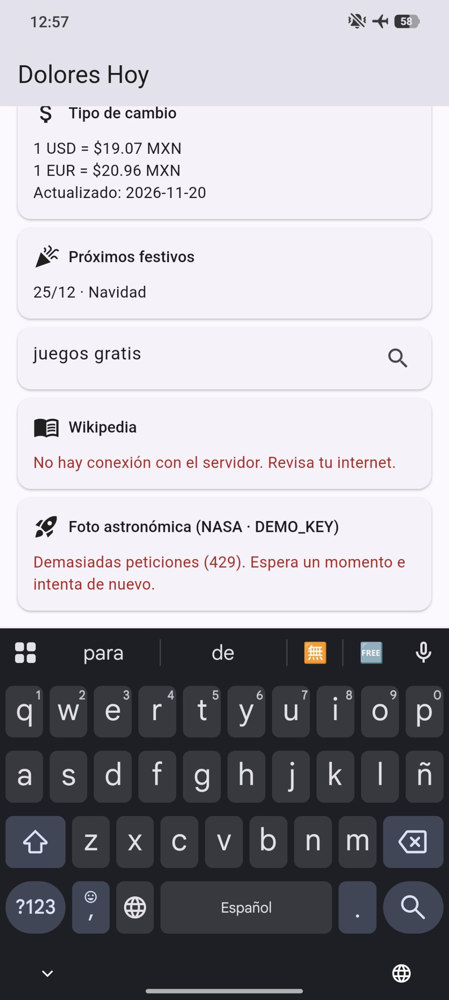
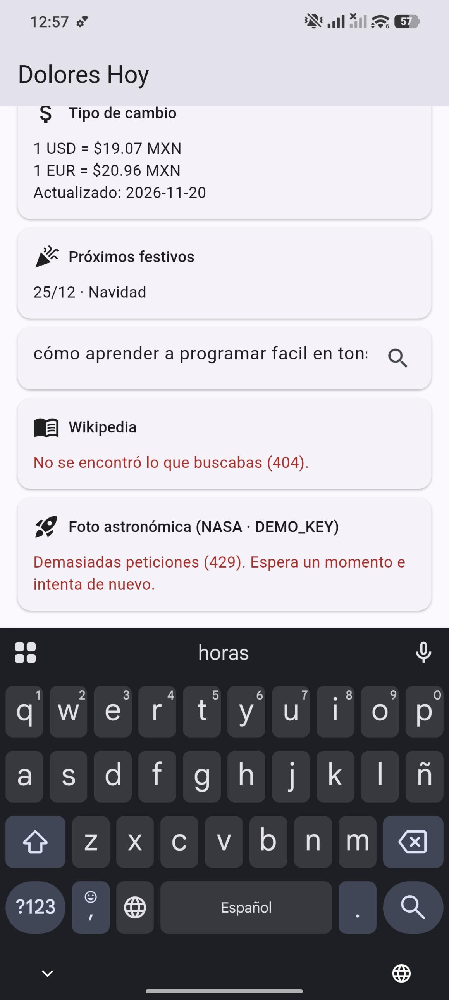

# Dolores Hoy — Flutter + 5 APIs gratuitas con seguridad

Tablero con **clima** (Open-Meteo), **tipo de cambio** (Frankfurter), **días festivos** (Nager.Date), **Wikipedia**
y la **foto astronómica de la NASA** (APOD, con clave). Construido con **TDD** siguiendo el *Manual paso a paso con
TDD — 5 APIs con buenas prácticas de seguridad*: un solo `ClienteSeguro` (solo HTTPS, timeout, límite de 1 MB, JSON
validado), claves fuera del código, entradas y salidas validadas (path injection, `soloHttps`, `media_type`) y
**resiliencia**: si una API cae, las otras cuatro siguen.

**Reto del manual incluido:** caja para buscar cualquier tema en Wikipedia (solo se recarga esa tarjeta).

---

## 📦 APK

| Archivo | Ruta |
|---|---|
| Lista para instalar | `apk/DoloresHoy.apk` (16.3 MB) |
| Salida de Flutter | `build/app/outputs/flutter-apk/app-release.apk` |

```bash
flutter build apk --release --target-platform android-arm64
```

El APK es para teléfonos **arm64** (prácticamente todos los Android de los últimos años). Para instalar: copia el `.apk` al teléfono, ábrelo y acepta *instalar apps de origen desconocido*.

La clave de la NASA **no está en el código**: entra al compilar. Sin clave se usa `DEMO_KEY` (límite muy bajo):

```bash
flutter build apk --release --target-platform android-arm64 --dart-define-from-file=secrets.json
```

`secrets.json` está en `.gitignore`; copia `secrets.json.example` y pon tu clave de api.nasa.gov.

---

## 🏗️ Estructura

```
lib/
├── dominio/        excepciones (mensajeSeguro) · modelos (Clima, TipoCambio, Festivo, ResumenWiki, FotoAstronomica)
├── datos/          cliente_seguro (ÚNICA puerta a internet) · config_claves · servicios (una clase por API)
├── presentacion/   tablero_viewmodel (Carga<T> por tarjeta) · pantalla_tablero
└── main.dart
test/  ayudas · cliente_seguro_test · servicios_test · seguridad_test · tablero_viewmodel_test
secrets.json.example   ← plantilla SIN secretos
```

---

## 🔴🟢🔵 Evidencia del ciclo TDD

### 1. 🔴 ROJO — las pruebas se escriben primero y fallan

Las pruebas de `test/` se escribieron **antes** que el código. Al correr `flutter test` con `lib/` todavía vacía, nada compila:



### 2. ❌ Error real atrapado por una prueba

El modelo `TipoCambio` del manual calcula los pesos por dólar invirtiendo la tasa:

```dart
double pesosPorUnidad(String moneda) => 1 / tasas[moneda]!;   // ❌ con tasa 0 → Infinity
```

Si el servidor (o alguien en medio) manda `"USD": 0`, la tarjeta mostraría **"1 USD = $Infinity MXN"**. Siguiendo la
regla del manual de *validar también la salida del servidor*, se escribió la prueba *"una tasa en cero no produce
Infinity"* y falló:



**Corrección:** validar al convertir el JSON; un dato absurdo se vuelve `RespuestaInvalidaException` con mensaje claro:

```dart
if (tasas.values.any((t) => t <= 0 || t.isNaN)) {
  throw const FormatException('Tasa de cambio inválida');      // ✅
}
```

**Segundo error (lo atrapó la corrida completa antes de compilar el APK):** `redactar()` ocultaba la clave con
`uri.replace(queryParameters: ...)`, pero `Uri` codifica los asteriscos y el log quedaba como
`api_key=%2A%2A%2A`. La prueba *"oculta la clave pero conserva el resto"* falló
(`Expected: contains 'api_key=***'`). Se corrigió armando la query a mano con `Uri.encodeQueryComponent` para los
valores normales y `***` literal para los secretos.

### 3. 🔵 REFACTOR — limpiar sin romper nada

`flutter analyze` señaló avisos de estilo:



Se corrigieron y se volvió a analizar:



### 4. 🟢 VERDE — las 42 pruebas pasan



### 5. 📦 Compilación del APK



---

## ✅ Qué cubren las pruebas

| Grupo | Lo que se verifica |
|---|---|
| Cliente seguro | rechaza `http://` sin hacer la petición, acentos, `Accept`/`User-Agent`, 429, 500, sin red, timeout, límite de tamaño, HTML |
| Logs | `redactar` oculta `api_key=***` y conserva lo demás |
| 5 APIs | clima y coordenadas, tipo de cambio (y tasa 0), festivos desde hoy (frontera), Wikipedia con path injection `../../admin`, NASA con/sin clave, video, http, 403 |
| Seguridad | `ConfigClaves` nunca imprime la clave, `DEMO_KEY`, clave vacía, `mensajeSeguro` no filtra detalles, `soloHttps` |
| Tablero | 5 tarjetas listas, una API caída no tumba a las demás, sin internet no truena, estados, buscar tema (reto) |

```bash
flutter test
```

---

## 📱 Capturas de la app

> Tomadas en un teléfono físico con el APK instalado. *Guarda tus capturas en `capturas/` con estos nombres y aparecerán aquí automáticamente.*

| Tablero completo | Foto de la NASA | Buscar en Wikipedia |
|---|---|---|
|  |  |  |

| Error: modo avión | Error: tema demasiado largo |
|---|---|
|  |  |

### Qué probar en la app

| Caso | Qué hacer | Resultado esperado |
|---|---|---|
| Todo bien | Abre la app con internet | Las 5 tarjetas se llenan casi al mismo tiempo |
| Buscar | Escribe `Talavera` y 🔍 | Solo cambia la tarjeta de Wikipedia |
| Tema inválido | Escribe 100 letras | "Dato inválido: tema demasiado largo" |
| Sin internet | Modo avión y jala para recargar | Las 5 tarjetas muestran un mensaje amable |

---

## 🛠️ Cómo correr el proyecto

```bash
flutter pub get
```

```bash
flutter test
```

```bash
flutter run
```

